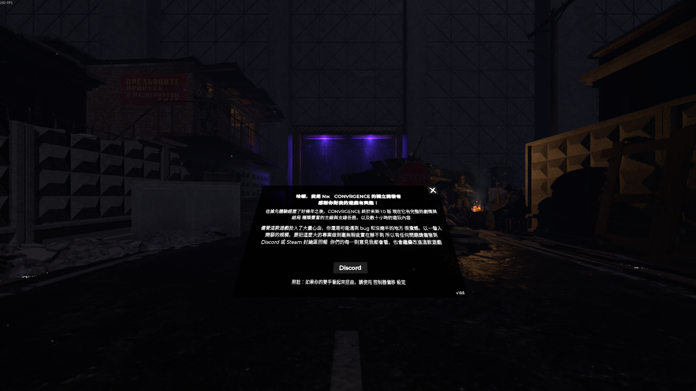
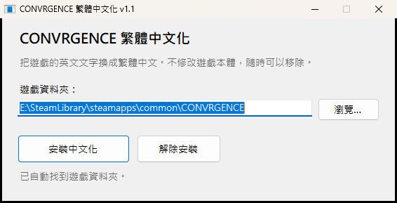

# CONVRGENCE 繁體中文化

非官方的 [CONVRGENCE](https://store.steampowered.com/app/2609610/) 英文→繁體中文化。
劇情對白、任務目標、教學提示、文件、物品名稱與說明，共約 1,700 條。

- 譯文是預先翻好的，不是即時機器翻譯，玩的時候不需要連網
- 不修改遊戲本體檔案，隨時可以開關或移除
- 遊戲語言維持 English 即可，不用切成俄文



## 下載

到 **[Releases](https://github.com/sakiwatashi/CONVRGENCEChinese-localization/releases/latest)** 下載，兩種擇一：

| 檔案 | 說明 |
|---|---|
| `CONVRGENCE-zh-TW-v1.1-Setup.exe` | 安裝程式，會自動找到遊戲，最簡單 |
| `CONVRGENCE-zh-TW-v1.1.zip` | 手動解壓縮到遊戲資料夾 |

目前版本對應遊戲 **2026-10-01** 更新後的版本。

## 安裝

### 方法一：安裝程式

1. 執行 `CONVRGENCE-zh-TW-v1.1-Setup.exe`
2. 確認「遊戲資料夾」是對的（通常會自動找到），按 **安裝中文化**
3. 照常從 Steam 啟動遊戲



> Windows 若跳出「Windows 已保護您的電腦」，按 **其他資訊 → 仍要執行**。
> 這是因為安裝程式沒有付費的數位簽章，Windows 不認得它。
> 不放心的話可以改用 zip，或自己從 `installer/` 的原始碼編譯。

### 方法二：手動解壓縮

1. Steam 收藏庫 → 對 CONVRGENCE 按右鍵 → **管理 → 瀏覽本機檔案**
2. 把 zip 裡的所有東西解壓縮到這個資料夾（`winhttp.dll` 要跟 `CONVRGENCE.exe` 在同一層）
3. 照常從 Steam 啟動遊戲

### 第一次啟動

會多花 10～30 秒準備，並跳出一個黑色的主控台視窗，這是正常的。之後啟動就會變快。

## 開關與移除

- **切換中英文**：遊戲關閉時，雙擊遊戲資料夾裡的 `toggle-chinese.bat`
- **移除**：用安裝程式的「解除安裝」，或刪掉遊戲資料夾裡的 `winhttp.dll`（完整清單見包內的 `README-zh-TW.txt`）

## 遊戲更新之後

大部分翻譯會繼續有效。開發者改寫過的句子會顯示回英文，等這裡推出新版即可。
更新後第一次啟動又會比較慢，是因為模組框架在重建檔案。

## 譯名對照

| 英文 | 中文 |
|---|---|
| the Zone | 禁區 |
| artifact | 遺物 |
| raid | 出擊 |
| Hideout | 藏身處 |
| stalker | 潛行者 |
| convergent shift | 匯聚偏移 |

任務地點一律用出擊選單上的四張地圖名稱：**森林、車庫合作社、地下設施、死城**。
遊戲任務裡寫的「(CITY)」「the City」都是指死城（遊戲沒有叫「城市」的地圖），所以譯成死城；
切爾諾卡緬斯克（Chernokamensk）是整座禁區城鎮的名字，死城在它裡面。

人名多數保留英文拼法（例如 Evglevsky）。

## 已知限制

- 少數文字要等畫面重新顯示一次才會變成中文

## 給維護者

```
translation/zh-TW/Text/   翻譯檔（XUnity.AutoTranslator 格式，原文=譯文）
package/                  隨包附的開關腳本、說明檔、授權條文
installer/                EXE 安裝程式原始碼（C#，用 Windows 內建 csc 編譯）
tools/                    打包、檢查工具
```

遊戲更新後的流程：

```bash
# 1. 哪些翻譯失效了（逐字比對遊戲裡的字串）
python -X utf8 tools/check_keys.py --game "<遊戲資料夾>"
# 2. 有哪些新文字還沒翻
python -X utf8 tools/find_new_strings.py --game "<遊戲資料夾>"
# 3. 翻譯後打包（需要遊戲資料夾裡已經裝好 BepInEx + XUnity.AutoTranslator）
python -X utf8 tools/build_package.py --game "<遊戲資料夾>"
powershell -ExecutionPolicy Bypass -File installer/build.ps1
```

翻譯檔的地雷：每一行**只能有一個沒跳脫的 `=`**，文字裡的 `=` 都要寫成 `\=`，否則整行會被靜默丟掉；
`//` 會被當成註解截斷該行。`tools/check_keys.py` 會把讀不進去的行列出來。

## 使用的開源元件

| 元件 | 授權 |
|---|---|
| [BepInEx](https://github.com/BepInEx/BepInEx) 6.0.0-be.788（IL2CPP） | LGPL-2.1 |
| [XUnity.AutoTranslator](https://github.com/bbepis/XUnity.AutoTranslator) 5.6.2 | MIT |
| [Il2CppInterop](https://github.com/BepInEx/Il2CppInterop) | LGPL-3.0 |
| [Cpp2IL](https://github.com/SamboyCoding/Cpp2IL)、[HarmonyX](https://github.com/BepInEx/HarmonyX) | MIT |
| .NET 6 執行環境 | MIT |

授權全文在 [`package/LICENSES`](package/LICENSES)，也隨下載包附上。

## 聲明

本專案為玩家自製，與開發商 Monkey-With-a-Bomb 無關。遊戲及原文著作權屬於原權利人。
下載包不含任何遊戲本體檔案，請使用正版遊戲。

---

**English:** Unofficial Traditional Chinese (zh-TW) translation for CONVRGENCE, built on BepInEx + XUnity.AutoTranslator.
Download the installer or zip from [Releases](https://github.com/sakiwatashi/CONVRGENCEChinese-localization/releases/latest), keep the in-game language set to English, and launch from Steam.
